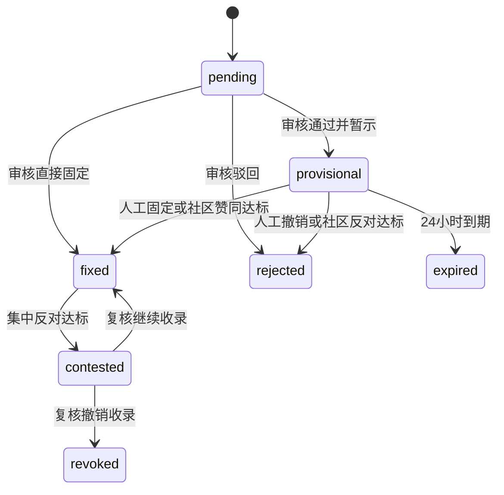
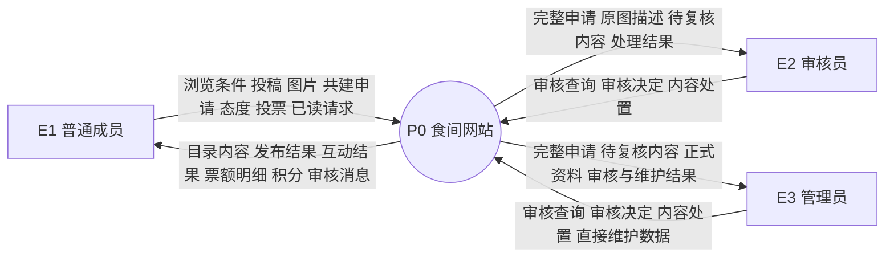
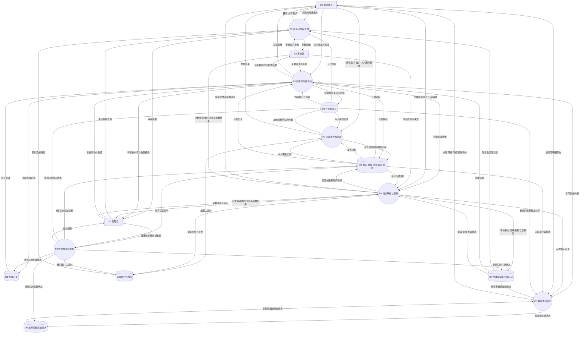
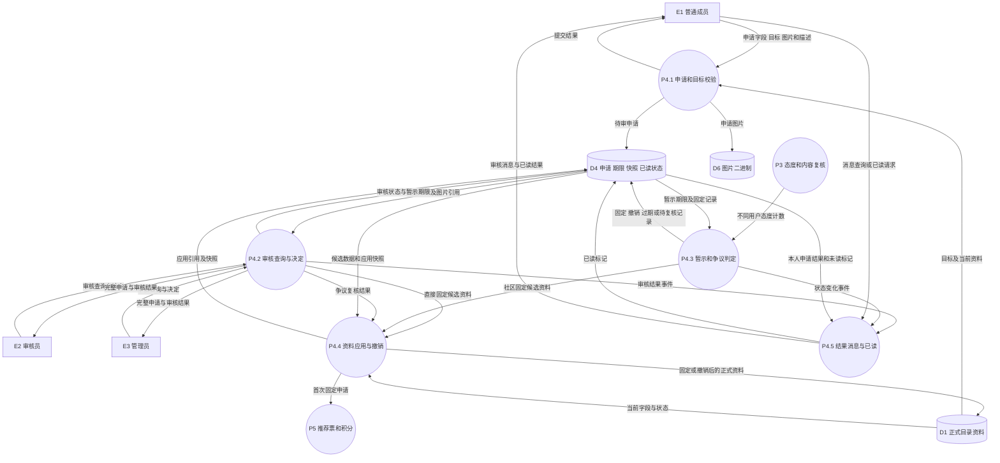
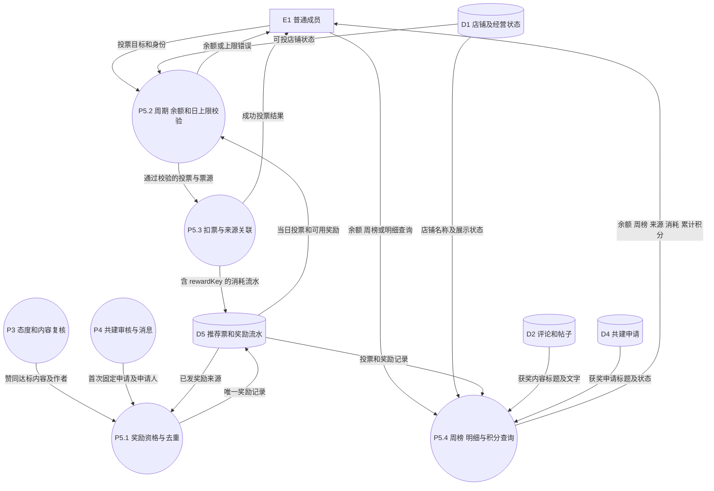

# 产品需求规格说明书（SRS / PRD）

版本：v0.3｜更新日期：2026-10-13｜基线：当前工作区 MVP 实现

本说明书依据 `src/app.js`、`src/repository.js`、`db.mjs` 和现有测试整理，包含本地尚未提交到 GitHub 的审核员及图片描述功能。**已实现**表示代码具备该行为，不表示已接入正式身份认证或通过公开部署验收。后续需求统一列在第 9 节，不混入当前功能验收。

## 1. 产品定义与范围

**食间是一个由师生共同完善食堂和店铺信息、分享菜品体验，并通过评论与推荐票发现校园美食的网站。**

网站覆盖两个校区，目录按“校区 → 食堂 → 店铺 → 菜品或口味”组织。采用空白目录起步，由用户提交共建申请，管理员或审核员确认。评价方式为文字评论、赞同与反对、推荐票；不设置星级、分数或综合评分。周榜反映推荐热度，不代表客观质量或食品安全结论。

### 1.1 当前角色与权限

发布人和浏览人都是普通成员，名称用于演示；审核员与管理员具有不同的工作台权限。四个身份可在侧栏自由切换，身份信息由代码中的 `demoUsers` 定义。

| 功能 | 发布人 / 浏览人 | 审核员 | 管理员 |
| --- | --- | --- | --- |
| 浏览、发帖、评论、投推荐票、提交共建 | 支持 | 支持 | 支持 |
| 赞同、反对、撤销或切换态度 | 支持；禁止对本人内容表态 | 同左 | 同左 |
| 删除自己的评论、帖子、图片 | 支持 | 支持 | 支持 |
| 审核申请：暂示、直接固定、驳回 | 不支持 | 支持 | 支持 |
| 提前固定或撤销暂示、处理固定资料争议 | 不支持 | 支持 | 支持 |
| 隐藏、恢复或移除评论、帖子、标签 | 不支持 | 支持 | 支持 |
| 直接新增或修改校区、食堂、店铺、菜品、图片 | 不支持 | 不支持 | 支持 |
| 直接下架、恢复目录资料、清空预览业务状态 | 不支持 | 不支持 | 支持 |
| 查看自己的审核消息、推荐票明细、积分 | 支持 | 支持 | 支持 |

直接维护接口要求管理员身份；审核接口允许管理员或审核员。此处是按传入演示身份进行的角色校验，尚无可信登录会话，不能作为正式防冒用认证。

## 2. 功能分解

### 2.1 功能分解图

以下为模块分解树，表达“系统包含哪些功能”，不是业务执行顺序。

```mermaid
flowchart TB
  ROOT[食间校园食堂共建网站]
  ROOT --> F1[目录与浏览]
  ROOT --> F2[图片与内容发布]
  ROOT --> F3[评价互动]
  ROOT --> F4[用户共建与审核]
  ROOT --> F5[推荐票与积分]
  ROOT --> F6[个人侧栏与直接维护]
  F1 --> F11[两校区食堂搜索与店铺浏览]
  F1 --> F12[食堂 店铺 菜品详情与层级导航]
  F1 --> F13[美食贴筛选 排序与详情]
  F2 --> F21[图片压缩 多图 缩略图与原图]
  F2 --> F22[图片分类 发布者与选填描述]
  F2 --> F23[富文本美食贴与三类目标评论]
  F3 --> F31[赞同 反对 切换与撤销]
  F3 --> F32[评论排序与阈值隐藏]
  F3 --> F33[标签追加与互动]
  F4 --> F41[新增资料 单项或多项修改 状态申请]
  F4 --> F42[审核员及管理员初审]
  F4 --> F43[24小时暂示 固定 撤销与争议复核]
  F5 --> F51[每日基础票与额外票奖励]
  F5 --> F52[每店每日上限与自然周榜]
  F5 --> F53[奖励来源 消耗明细与累计积分]
  F6 --> F61[四身份切换 我的消息与一键已读]
  F6 --> F62[我的发布概况与本人内容删除]
  F6 --> F63[管理员直接维护及角色限制]
```

### 2.2 模块与实现位置

| 模块 | 主要职责 | 当前实现位置 |
| --- | --- | --- |
| F1 目录与浏览 | 层级数据展示、搜索筛选、详情路由、相关帖子 | `src/app.js` |
| F2 图片与发布 | 图片压缩、描述、富文本清理、持久化媒体 | `src/image-compression.js`、`src/rich-text.js`、`media.mjs`、`db.mjs` |
| F3 评价互动 | 单人单态、去重、自评限制、隐藏、标签同步 | `src/repository.js`、`src/content-filter.js` |
| F4 共建与审核 | 目标校验、申请状态、字段应用、复核和审核消息 | `src/repository.js`、`src/app.js` |
| F5 推荐票与积分 | 日期周期、奖励去重、扣票、账目关联、榜单统计 | `src/repository.js`、`src/app.js` |
| F6 侧栏与维护 | 身份展示、已读、本人内容管理、管理员权限 | `src/app.js`、`src/api-repository.js`、`src/repository.js` |

## 3. 页面与交互需求

| 页面 / 区域 | 当前展示和操作 | 主要约束 |
| --- | --- | --- |
| 首页 | 项目定义、浏览食堂、共建说明、本周前三店铺、CSS 餐盘动画 | “了解共建方式”定位首页末尾；已删除重复食堂导览区块 |
| 食堂展示 | 校区切换、食堂名称或位置搜索、食堂卡片、添加食堂卡片 | 搜索作用于当前校区；已有食堂时仍保留添加卡片 |
| 食堂详情 | 标题照片、位置、营业时间、店铺卡片、暂示申请及前六条固定共建记录 | 固定记录不带表态按钮；照片弹窗末尾有添加卡片 |
| 店铺详情 | 门面或菜品图、位置、多标签、营业状态、延时关门、菜品价格、评论、推荐票 | 菜品资料只能进入菜品详情修改；没有重复“查看详细”按钮 |
| 菜品详情 | 名称或口味、价格、说明、可售状态、多图、评论 | 字段采用统一可点击共建样式 |
| 图片窗口 / 放大层 | 全部图片、上传入口、分类、发布者和描述 | 描述选填，最多 200 字；无描述显示“未填写描述” |
| 美食贴列表 / 详情 | 校区、食堂、店铺筛选；时间或赞同排序；正文、图片和评论 | 店铺相关帖子显示最高赞同前三，另有全部帖子页面 |
| 共建表单 | 选择目标、新增资料或勾选修改条目、图片与描述 | 详情页上级目标锁定且隐藏选择器；用户只填写必要条目 |
| 用户侧栏 | 概览、我的消息、我的发布、身份切换、票据明细 | 点“我的推荐票”打开来源与消耗；消息支持单条及一键已读 |
| 审核 / 管理工作台 | 待审、暂示、内容分类与状态筛选、关键词检索、排序、展开更多 | 审核员不显示直接维护、目录恢复和清空入口 |
| 管理员直接维护 | 左侧选择食堂、右侧过滤店铺，完整资料编辑表单 | 所有直接维护接口校验管理员身份 |
| 网站评价规则 / 未来计划 | 当前阈值、票制、积分试行及后续能力说明 | 未完成能力明确标为规划中 |

详情页使用独立 URL，刷新后根据路径恢复食堂、店铺、菜品或帖子页面。目录层级导航带所属校区，支持返回上级。

## 4. 当前功能需求与验收

### 4.1 目录和资料

| 编号 | 要求及验收依据 |
| --- | --- |
| CAT-01 | 系统保留两个可改名校区；食堂、店铺初始允许为空，并显示共建入口 |
| CAT-02 | 食堂记录名称、位置、营业时间与图片；店铺记录名称、位置、所属食堂、标签和延时关门说明 |
| CAT-03 | 菜品记录名称或口味、参考价格、说明、供应状态；允许同一菜品关联多张图片 |
| CAT-04 | 店铺标签支持追加一个或逗号分隔的多个标签，不覆盖旧标签；最多八个，每个最多二十字 |
| CAT-05 | 店铺营业状态为正常营业、暂示闭店、下架，依次用绿、黄、红标识；经营状态下架的店铺仍可查看，暂停接收推荐票 |
| CAT-06 | 菜品状态为可售、下架；用户申请固定后才更改正式状态，下架菜品从公开菜品列表移除 |
| CAT-07 | 管理员直接下架目录记录使用 `archived`，与店铺经营状态 `unlisted` 不同；已下架食堂或店铺有管理员恢复入口 |

营业时间和价格当前为文本字段，尚未实现按星期、节假日或货币数值的结构化校验。

### 4.2 图片和描述

| 编号 | 要求及验收依据 |
| --- | --- |
| IMG-01 | 上传支持 JPG、PNG、WebP；超过 900,000 字节时在浏览器压缩，压缩失败给出提示 |
| IMG-02 | 食堂照片、店铺门面和菜品照片均支持选填个人描述；描述与分类、菜品名称分别保存 |
| IMG-03 | 管理员直接上传及美食贴插图也支持描述；图片描述最多 200 字，共建和直接维护中的描述经过演示词库筛选 |
| IMG-04 | 待审申请列表和审核确认窗口显示目标、申请字段、图片分类、描述、提交者，图片可放大查看 |
| IMG-05 | 放大图片底部显示“图片分类 · 发布者想说：描述”；旧图片无描述时显示“未填写描述” |
| IMG-06 | 列表和预览请求缩略图，放大层先显示预览再加载原图；可点外部空白、关闭按钮或按 Escape 关闭 |
| IMG-07 | 图片保存、暂示、固定后保留描述和发布者关联；MySQL 模式图片二进制与文字状态分离 |

### 4.3 评论、帖子和态度

| 编号 | 要求及验收依据 |
| --- | --- |
| CNT-01 | 可以评论店铺、菜品、美食贴；每条最多 500 字；不开放回复和多层回复 |
| CNT-02 | 评论支持时间降序、赞同数降序；用户可删除本人评论，当前不支持重新编辑已发评论 |
| CNT-03 | 帖子必须关联一个已收录店铺，标题最多 80 字、正文最多 5,000 字；富文本支持常用字体效果、标题、列表和最多三张正文插图 |
| CNT-04 | 帖子支持详情、评论、赞同、反对及作者删除；当前不支持收藏或重新编辑已发帖子 |
| CNT-05 | 标签、评论、帖子及暂示或固定的共建记录支持赞同和反对；每用户每对象只有一个当前态度，可改选或取消；禁止自评 |
| CNT-06 | 计数按不同 `actorId` 去重；本人态度不计入门槛；重复记录不使奖励提前达到阈值 |
| CNT-07 | 评论、帖子、标签反对数至少 5 且不少于赞同数的两倍时自动隐藏；审核员或管理员可隐藏、恢复、移除 |
| CNT-08 | 隐藏标签退出公开标签集合；评论在公开区域显示折叠提示；隐藏帖子退出公开列表和详情 |
| CNT-09 | 人工恢复内容设置 `moderationLocked`，避免已有反对计数使它立即再次自动隐藏 |

屏蔽词库为 `demo-1` 的少量演示词；尚无后台词库维护、语义判断或正式内容审核服务。

### 4.4 共建、暂示与状态

新增食堂、店铺、菜品、图片，以及资料字段或营业状态修改都先形成申请。资料字段可单项或多项提交，申请保留校区、食堂、店铺、菜品的目标标识。

这是申请状态图，与第 6 节描述数据传递的 DFD 用途不同。

| 编号 | 当前规则 |
| --- | --- |
| CON-01 | 管理员和审核员均可把待审申请设为暂示、直接固定或驳回；审核员不能自行改写正式资料字段 |
| CON-02 | 暂示持续 24 小时，独立展示；尚未固定的申请不覆盖原正式字段 |
| CON-03 | 暂示赞同人数至少 5 且赞同多于反对时自动固定；反对人数至少 5 且反对不少于赞同时提前撤销 |
| CON-04 | 已固定记录反对数至少 5 且不少于赞同数的两倍时进入 `contested`；复核前正式资料仍保留，尚无自动回退或复核到期规则 |
| CON-05 | 固定时保存已应用变更的引用或快照；复核撤销据此恢复或下架相关资料；旧记录无快照时需管理员人工维护 |
| CON-06 | 店铺、菜品状态申请保存原状态；若原状态已经被改变，旧申请固定时拒绝覆盖，需重新提交 |
| CON-07 | 页面加载和打开页面后的每分钟检查可触发暂示过期处理；尚无独立服务端定时任务 |
| CON-08 | 每次审核状态变化重置申请的未读标记；单条或一键已读只影响本人的已处理申请，不影响待审及其他用户 |

### 4.5 推荐票、来源追溯和积分

| 编号 | 当前规则 |
| --- | --- |
| VOT-01 | 采用北京时间自然日和周一开始的自然周；每人每日基础票一张，未使用不结转 |
| VOT-02 | 额外票跨日、跨周保留；投票优先使用基础票，之后消耗未使用奖励票 |
| VOT-03 | 每人对同一店每天最多三张，基础票和额外票合计；缺余额、店铺不存在或经营下架时拒绝投票 |
| VOT-04 | 评论达到五名不同用户赞同、帖子达到十名不同用户赞同、共建首次固定时分别奖励一张 |
| VOT-05 | 用“来源类型 + 内容 ID”去重奖励；反复取消再赞同不重复发票；已发奖励不因普通取消赞同自动收回 |
| VOT-06 | 隐藏或移除内容不新获得赞同奖励；目前没有每周奖励上限、待发队列、反刷评分或奖励冲正接口 |
| VOT-07 | 周榜按本周流水统计，新周自然从零计数；旧流水和额外票保留，不靠删除数据清榜 |
| VOT-08 | 同票按店铺名称的中文排序比较；当前不采用最早达到票数的时间作为并列规则 |
| VOT-09 | 点个人概览的推荐票卡片查看奖励来源、使用状态、投票目标和时间；新额外票流水记录 `rewardKey`，旧记录的对应关系明确标为推定 |
| VOT-10 | 暂定每次成功投票累计一积分，由本人投票流水数量计算；积分卡片为试行占位，不存在兑换、扣积分或独立积分钱包 |

MySQL 模式在事务中锁定 `app_state` 行，执行余额检查、扣票、发奖和状态写入。重复点击仍是多个请求，但余额和同店日上限约束会逐次执行；尚无客户端请求幂等键。

四个演示身份中，作者不能自评，因此一条内容最多从其余三个身份获得赞同，无法自然达到五人或十人阈值；边界测试使用额外的测试互动记录，不代表已接入真实用户。

### 4.6 工作台和个人空间

| 编号 | 要求 |
| --- | --- |
| WRK-01 | 共建审核卡片及确认弹窗展示完整目标路径、修改字段、价格、图片和描述；固定或驳回后申请人可查看结果 |
| WRK-02 | 内容工作台支持全部 / 评论 / 帖子 / 标签切换，公开 / 隐藏状态筛选，内容、作者、食堂店铺检索 |
| WRK-03 | 内容可按最新、最早或反对数排序，首批十二条，可继续展开；展示内容位置及赞同反对数 |
| WRK-04 | 审核员界面隐藏直接维护、目录恢复和清空入口；接口同样拒绝审核员、普通成员及缺失身份的直接维护请求 |
| WRK-05 | 我的发布展示本人帖子、评论、图片数量及部分帖子入口；它不是完整的全部内容管理列表 |
| WRK-06 | 我的消息当前仅包含共建审核结果；尚无评论隐藏、奖励到账、举报申诉等独立消息类型 |

## 5. 核心用户流程

1. 浏览：首页 → 食堂展示 → 校区与食堂 → 店铺 → 菜品；详情 URL 可直接访问或刷新恢复。
2. 上传图片：图片窗口的空白卡片 → 锁定或选择目标 → 选择分类与图片 → 选填描述 → 待审申请 → 审核后暂示或固定 → 图片放大查看。
3. 共建修改：点击资料字段 → 勾选修改条目 → 提交目标和新值 → 审核员或管理员处理 → 固定后写入正式资料，申请人获得一次奖励。
4. 内容互动：发表评论或帖子 → 词库筛选 → 其他身份表态 → 更新计数 → 判断奖励及隐藏 → 必要时人工复核。
5. 推荐：查看余额 → 投给店铺 → 扣基础票或具体奖励票 → 写入投票流水 → 周榜与累计积分更新 → 侧栏查询明细。
6. 消息：审核状态变化 → 本人侧栏出现未读 → 单条或一键已读 → 未读数量更新。

## 6. DFD 数据流图

### 6.1 表示约定及范围

DFD 描述数据从外部实体，经处理过程，流入或流出数据存储的关系。矩形表示外部实体，圆形表示处理过程，数据库形节点表示数据存储；箭头标签为传递的数据。DFD 不表达按钮先后顺序或条件分支。

系统边界包含网页、Node.js 服务和业务数据。E1 为普通成员的使用行为；审核员和管理员也可执行 E1 的一般行为。学校登录服务尚未接入，因此不画成当前外部实体。MySQL 是系统内部存储，不画成外部用户。

D1–D5 是 `app_state.payload` 内的**逻辑存储分区**，不是五张已经创建的 MySQL 表；D6 对应 `app_media`。浏览器预览模式以 localStorage 和 Data URL 保存同类数据，图中以 MySQL 模式为基准。

### 6.2 上下文图

### 6.3 顶层图（Level 0）

个人图片删除归入 P2，会更新 D1 中该图片的公开引用；管理员清空状态会重置 D1–D5 的 JSON 分区，不清除 `app_media` 二进制。图中的跨分区更新对应同一 JSON 的写入，不能理解成独立表之间的自动级联。

### 6.4 P4 共建审核与消息的一级分解

P4.3 的到期计算使用运行时日期，由页面加载和周期检查触发；它不表示已经部署了后台任务。图中“完整申请及图片引用”包含图片描述，二进制或原图仍通过图片读取过程取得。

### 6.5 P5 推荐票和积分的一级分解

P5.2 与 P5.3 在 MySQL 模式的同一事务中执行；积分是统计结果，没有独立积分存储。P5.1 只对新达标且未发奖的来源写奖励，重复取消再赞同不会形成新来源。

### 6.6 外部实体和数据字典

| 标识 | 数据集合 | 关键数据项 | 实际位置 |
| --- | --- | --- | --- |
| E1 | 一般使用行为 | 演示 actorId、浏览条件、投稿、申请、态度、投票 | 浏览器请求；身份定义在代码 |
| E2 | 审核行为 | 审核目标、决定、说明、内容处置 | 审核员请求 |
| E3 | 管理行为 | 审核数据及直接维护字段 | 管理员请求 |
| D1 | 目录 | campuses、canteens、shops；内含 dishes、photos、tagRecords | `app_state.payload` |
| D2 | 社区内容 | comments、posts；ownerId、body、contentHtml、status | 同上 |
| D3 | 互动 | actorId、targetKind、targetId、stance、updatedAt | 同上的 reactions |
| D4 | 共建与消息 | 目标、changes、photoDescription、status、expiresAt、applied、notificationReadAt | 同上的 contributions |
| D5 | 推荐票与奖励 | recommendationVotes、recommendationRewards；day、week、source、rewardKey、key | 同上 |
| D6 | 图片 | hash、mime、body、created_at；文字描述不在此表 | `app_media` |

主要流“共建申请”包含目标、类型、修改条目和选填描述；“审核决定”包含申请 ID、处理方式与说明；“态度”包含对象和赞同 / 反对；“投票”包含店铺和身份，日周周期由程序计算；“奖励”包含作者、唯一来源键和时间。

父图与子图使用相同的外部角色、D1/D4/D5/D6 和审核、候选资料、固定奖励、消息等边界数据。P3、P5 在 P4 子图中作为相邻处理过程显示，不新增学校接口、支付平台或独立通知服务。

## 7. 非功能需求与当前限制

| 项目 | 当前实现 | 后续验收目标 |
| --- | --- | --- |
| 可用性 | 中文响应式页面、空状态、加载错误提示、路径恢复 | 常见手机与桌面浏览器人工检查 |
| 数据一致性 | MySQL 事务和单状态行锁；同内容奖励去重 | 真实多用户并发压测及业务分表 |
| 加载 | 图片分离、缩略图、原图渐进加载、懒加载、缓存 | 在实际校园网络采样指标后设置 SLA |
| 权限 | 操作按演示角色校验 | 服务端可信会话，不能相信客户端 actorId |
| 内容安全 | 演示词库、前端富文本允许列表、图片类型和体积限制 | 服务端 HTML 清理、真实图片内容审核、反刷与审计 |
| 运行 | 仅监听 127.0.0.1；MySQL 模式连接失败则启动失败 | 公开部署、HTTPS、会话和网络访问策略另行设计 |
| 追溯 | 当前态度、推荐票来源、申请应用快照及部分时间字段 | 完整不可变操作日志和规则版本历史 |

API `/api/state` 当前返回全量业务状态，不能实现正式意义上的按角色隐藏敏感记录；客户端刷新仍会重新读取状态。媒体备份表用于特定迁移，不替代完整定期备份。

## 8. 验收用例与测试对应

| 场景 | 验收结果 | 现有测试 |
| --- | --- | --- |
| 跨校区目标错配 | 拒绝提交，不改数据 | `tests/contribution-smoke.mjs` |
| 评论及帖子反复撤销再赞同 | 每个内容奖励仍只有一条 | `tests/recommendation-votes.mjs` |
| 基础票、额外票、日上限、跨周 | 余额和账目符合第 4.5 节 | 同上 |
| 暂示四票与五票边界、集中反对 | 四票保留暂示，达五票按净态度判定；固定争议可复核 | `tests/reactions-moderation.mjs` |
| 审核员审核与越权维护 | 允许审核，拒绝直接维护及缺失身份 | `tests/reviewer-permissions.mjs` |
| 图片描述空值、长度、固定及编辑 | 描述与作者保留；超过上限拒绝 | `tests/image-descriptions.mjs` |
| 一键已读 | 只修改本人已处理未读申请 | `tests/contribution-smoke.mjs` |
| 店铺及菜品状态申请 | 暂示不覆盖正式值，过时申请拒绝覆盖 | `tests/status-updates.mjs` |
| 媒体迁移和图片读取 | 保留原状态备份，二进制分离，缩略图可读取 | `tests/media-storage.mjs` |

现有脚本通过不等于已完成真实账号安全测试、浏览器端到端测试或生产负载验证。

## 9. 后续需求与明确排除

| 项目 | 当前状态 | 后续决策 |
| --- | --- | --- |
| 学校登录、真实用户与账号限制 | 未实现 | 等接口申请结果确定凭证及角色来源 |
| 收藏、已发布内容编辑、完整我的发布管理 | 未实现 | 在现有帖子和本人内容模型上补充 |
| 举报、申诉、账户封禁、独立通知中心 | 未实现 | 确定运营负责人和处置规则 |
| 规范化业务表、审计日志、幂等请求、后台任务 | 未实现 | 公开多用户试点前补齐 |
| 每周奖励上限、反刷、冲正、历史周榜快照 | 未实现 | 结合真实身份和试点数据制定；不把旧建议值当现行规则 |
| 低参与店铺探索推荐、AI 推荐 | 未实现 | 当前仅有本周热度榜；建立推荐评估方案 |
| 积分兑换校园周边或学习用品 | 仅占位 | 明确兑换来源、规则、积分账本和审批 |
| 三维食堂、微信小程序、赞助 | 仅规划说明 | 单独立项和确认授权 |
| 星级打分、交易、支付、外卖订单 | 不在当前范围 | 如改变定位需重新定义需求 |
