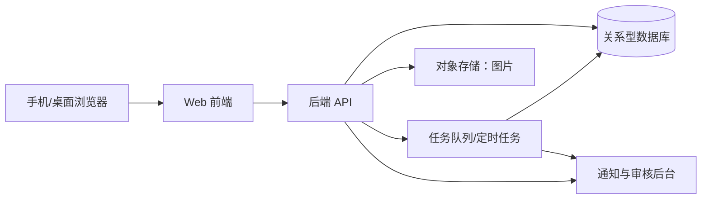

# 技术与数据方案（初稿）

版本：v0.1｜日期：2026-10-02

> 2026-10-03 实现状态：本机 MySQL 8.0 已接入原型。当前仅建立 `canteen_guide_mvp.app_state`，用一行 JSON 保存演示资料；下文的规范化表、图片对象存储、登录鉴权与投票事务仍是正式版设计，不代表已实现。服务只监听 `127.0.0.1`，数据库密码仅在被 Git 忽略的 `.env.local` 中。图片目前以受限大小的 Data URL 存于预览状态，正式版需采用独立图片存储与审核流程。

## 1. 设计原则

1. 先做单体 Web 服务与单个关系型数据库，避免早期拆分服务带来的部署与事务复杂度。
2. 推荐票、奖励和资料版本是关键资产，使用可追溯流水；页面上的计数是派生结果，可重算。
3. 公开内容与正式店铺资料分离；用户申请先经管理员审核，再暂示或固定；管理员可直接修改并保留版本。
4. 规则阈值可配置但要版本化；历史事件按当时规则解释。
5. 前端可替换，业务规则集中在服务端，以便后续复用到微信小程序。

## 2. 参考架构

可选实现：前端 React/Vue 任一成熟框架，后端 Node.js、Java 或 Python 中团队熟悉的一种，数据库 PostgreSQL 或 MySQL，对象存储保存图片。选型应以团队能力、部署环境和维护者为准；不需要在立项时锁死框架版本。试点期若流量低，可用同一应用部署前台 API 与后台，数据库独立备份。

## 3. 领域模型与数据字典

所有表建议含 `id`、`created_at`、`updated_at`；时间以 UTC 存储，业务周期按 `Asia/Shanghai` 计算。

| 实体 | 关键字段 | 约束/用途 |
| --- | --- | --- |
| `users` | 外部身份映射可选、昵称、头像、状态、角色 | 正式登录凭证待学校接口确认；测试账号与正式账号隔离 |
| `campuses` / `canteens` | 名称、位置描述、每周营业时段、节假日例外、状态 | 两校区与食堂骨架可先创建，店铺允许为零 |
| `shops` | 食堂 ID、名称、位置、分类、营业状态、延时关门时段及适用日期、当前资料版本 ID | 稳定店铺 ID；迁址/关店不删除关联 |
| `shop_versions` | 店铺 ID、结构化资料、来源、确认人、有效期 | 正式资料变更可追溯、可回滚 |
| `dishes` | 店铺 ID、名称、价格、价格更新时间、说明、状态、资料版本 | 价格可暂缺并显示待补充；菜品可增改下架 |
| `media_assets` | 上传者、对象键、内容类型、大小、审核状态、来源说明 | 原图隔离；公开用处理后的图片 |
| `comments` | 作者、目标类型/ID、正文、可见状态、版本 | 同时服务店铺评论与帖子评论；目标类型白名单 |
| `posts` | 作者、主关联店铺、标题、正文、状态、版本 | 店铺帖子关联查询 |
| `reactions` | 用户、目标类型/ID、态度 | 每用户每目标唯一；赞同/反对/取消更新当前态 |
| `bookmarks` | 用户、帖子 ID | 每用户每帖子唯一 |
| `vote_periods` | 周起止、状态、规则版本 | 一周一个周期；唯一周开始时间 |
| `vote_ledger` | 用户、店铺、周期、票源、业务日期、类型、关联事件 | 不可变流水；投票和冲正都记记录 |
| `vote_allowances` | 用户、日期、基础额/已用额 | 可由规则与流水推算，作为并发控制行 |
| `bonus_grants` | 用户、来源类型/ID、授予时间、数量、发放状态 | 来源唯一；奖励票保留，不随每周榜单清空；超周上限可待发 |
| `contributions` | 申请人、目标、变更类型、候选内容、状态、暂示到期、规则版本 | 共建状态机主体 |
| `contribution_events` | 申请 ID、旧状态、新状态、原因、操作者 | 状态变更审计 |
| `reports` / `appeals` | 提交人、目标、理由、状态、处置 | 内容治理闭环 |
| `notifications` | 用户、类型、对象、已读状态 | 站内通知 |
| `audit_logs` | 操作者、动作、目标、前后摘要、时间 | 管理和异常操作追溯 |

### 3.1 关键唯一约束与索引

- `reactions(user_id, target_type, target_id)` 唯一；`bookmarks(user_id, post_id)` 唯一。
- `bonus_grants(source_type, source_id, reward_policy_key)` 唯一，确保同一来源只奖励一次。
- `vote_periods(start_at)` 唯一。投票请求使用客户端幂等键，`vote_ledger(user_id, idempotency_key)` 唯一。
- 同店每天最多 3 票，不能用 `user_id, shop_id, local_date` 唯一约束。应在事务中锁定用户-店铺-日期的计数行，检查 `< 3` 后递增；配合投票幂等键和余额锁防并发超投。
- 常用查询索引：店铺按食堂/分类/状态；评论按目标/公开状态/创建时间；帖子按店铺/公开状态/时间；推荐票按周期/店铺聚合。
- 所有外键默认限制误删，后台删除采用软删除或状态变更。

## 4. 核心事务与任务

### 4.1 投推荐票

1. 服务端确认用户资格、当前上海日期与周周期；客户端时间不参与判定。
2. 在数据库事务中锁定用户当日基础票额、持久奖励余额和用户-店铺-日期投票计数，检查同店当天已投数 `< 3`。
3. 优先消耗当日基础票，再消耗最早获得的奖励票（具体优先级可调整，但须固定）。奖励票跨日、跨周保留，周榜切换不得清除余额。
4. 写入唯一幂等键、票源和店铺的投票流水，更新聚合计数；事务提交后返回最新余额与票数。
5. 若重试命中幂等键，返回第一次操作结果；同店当天已投 3 张则返回“今天对该店已达上限”。

避免仅在缓存中扣票。若聚合计数与流水不一致，以流水重算并报警。

### 4.2 周切换与榜单

采用基于时间区间的自然周 ID，查询总是落在明确周期；因此即使定时任务延迟，新周票也不会算进旧周。周切换任务负责冻结旧周快照、处理待发奖励、准备新周展示，任务带唯一执行标识可补跑。**奖励票余额不在周切换时到期或清零**。旧周流水、快照和奖惩记录按保留政策保存；“清空”只指店铺新周榜从零计数。

### 4.3 赞同/反对、奖励与隐藏

互动变更在事务中更新当前态并写事件；计数由有效互动得出或同步维护。奖励判定依“不同有效用户”和规则版本，写 `bonus_grants` 时依赖唯一约束保证只发一次，超过即时发放上限的奖励留在待发状态。隐藏判定触发“隐藏待审”事件；被举报内容可直接进入审核队列。评论提交前先用版本化屏蔽词库扫描，命中规则可拦截或待人工复核，并给作者明确反馈；词库命中不等于最终违规认定。管理员恢复时记录原因，避免下一次普通互动立即重复隐藏。

### 4.4 共建状态与资料版本

共建申请的“候选资料”不直接改 `shops` 正式字段。提交后先进入管理员审核队列，管理员可驳回、批准暂示 24 小时或直接固定。暂示期独立展示；固定时创建 `shop_versions` 新版本并原子切换当前版本指针。管理员直接编辑也创建新版本，管理员“删除”使用可恢复的下架状态。固定后复核暂示则回退指针到上一已确认版本，但保留候选版本和事件链。若已有更新的正式版本，自动回退可能覆盖后续修改，此时必须进入人工冲突审查。关店/迁址/新店等高影响申请需更严格核验。

### 4.5 图片处理

上传时限制大小、数量和 MIME 类型，校验文件实际类型；去除 EXIF 定位信息，生成缩略图和适合展示的图片。上传文件先隔离，审核通过才获得公开访问地址。作者确认有权上传，用户可举报侵权或不当图片。删除内容后移除公开引用，底层文件按保留政策清理。

## 5. 接口草案

接口路径只是设计草案，可统一使用 REST 或 GraphQL；服务端始终做鉴权和参数校验。

| 方法/路径 | 功能 | 权限 |
| --- | --- | --- |
| `GET /api/canteens` | 食堂列表 | 公开 |
| `GET /api/shops` | 搜索、筛选、分页 | 公开 |
| `GET /api/shops/{id}` | 店铺详情及正式/暂示资料 | 公开 |
| `GET /api/leaderboard?week=...` | 本周/历史榜单 | 公开 |
| `POST /api/shops/{id}/votes` | 投推荐票，带幂等键 | 登录 |
| `GET /api/me/vote-wallet` | 今日票额与奖励流水 | 登录 |
| `POST /api/comments` | 评论店铺或帖子 | 登录 |
| `PUT /api/reactions/{target}` | 赞同/反对/取消 | 登录 |
| `POST /api/posts` | 发布美食贴 | 登录 |
| `POST /api/posts/{id}/bookmarks` | 收藏 | 登录 |
| `POST /api/contributions` | 提交共建申请 | 登录 |
| `POST /api/reports` | 举报 | 登录 |
| `POST /api/appeals` | 申诉 | 登录 |
| `GET /api/admin/review-queue` | 审核队列 | 审核员 |
| `POST /api/admin/reviews/{id}/decision` | 审核处置 | 审核员 |
| `PATCH /api/admin/shops/{id}` | 管理员直接编辑正式资料并生成版本 | 管理员 |
| `DELETE /api/admin/shops/{id}` | 管理员下架店铺并记录原因，可恢复 | 管理员 |

列表接口应分页、限制最大页大小；搜索须防恶意超长输入。图片上传可用服务端签发短期上传凭证，避免暴露对象存储密钥。

## 6. 安全、隐私与治理设计

- 身份：正式登录凭证待学校接口申请结果确定；设计独立身份适配层，内部测试账号与未来正式用户隔离。管理员账户必须有受控登录方式。公开投票和共建不能依赖匿名浏览器标识。
- 授权：普通用户只能编辑自己的内容；审核员和管理员权限按对象与动作校验，前端隐藏按钮不能代替服务端授权。
- 会话：使用安全 Cookie 或短期令牌，HTTPS，防 CSRF 和会话固定；退出登录使会话失效。
- 输入：富文本采用受限格式或 Markdown 清洗；输出转义，防 XSS；数据库参数化查询。
- 滥用：投票、互动、登录、发帖、上传均限速；异常互赞团和大量新账号列入人工审查。设备/IP 只作为风险线索，不作为唯一身份依据。
- 最小化：公开页不显示学号、手机号、邮箱、精确登录记录；日志不写验证码。提供隐私告知、导出/删除或注销处理流程。
- 审核：定义公开内容规则、举报类别、申诉与复核时限；保留处置审计。对涉及个人信息和严重不当内容，管理员可先紧急下架后复核。
- 备份：数据库每日备份、异地或独立存储副本，定期验证可恢复性；对象存储与数据库版本要能对应。

## 7. 性能与容量估算方法

待确认输入：在校人数、预计注册比例、日活、每人日均浏览/评论/投票次数、平均图片大小与数量、保留年限。用这些参数估算：

- 日请求量 ≈ 日活 × 每人日均页面/接口请求数；按峰时放大系数设计。
- 图片存储 ≈ 店铺与帖子图片数 × 处理后平均大小 × 备份/版本系数。
- 推荐票流水 ≈ 日活投票人数 × 每日平均投票数 × 保留天数。

试点先做负载基线，再按实际监控扩容。不要为未知的全校流量预先引入复杂分布式系统。

## 8. 扩展预留

- **三维食堂**：保留食堂/楼层/店铺稳定 ID；告示牌可作为带空间坐标的内容目标，沿用评论、互动、举报与审核模型。三维模型采集、移动端性能、地图版权和位置准确性需单独验证。
- **AI 推荐**：先沉淀经用户同意的行为与反馈指标；避免把“热度”误说成个性口味。后续需可解释、可关闭和质量评估。
- **微信小程序**：后端 API 不依赖网页会话表现；小程序登录与隐私授权另行设计，图片与内容规则复用。
- **赞助**：广告/赞助位与自然排名分开存储和显示，不允许付费改变推荐票数；商业合作、标识和结算规则另行立项。

后续四项可在导航中预留“规划中”入口，但不得呈现为已可用功能；点击后说明尚未开放，不收集无关个人资料。
