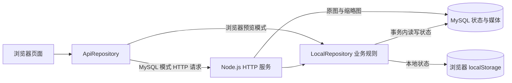

# 技术与数据方案

版本：v0.3｜更新日期：2026-10-13｜对应当前 MVP 代码

本文第 1–7 节描述已实现架构，第 8 节为后续设计。当前业务数据使用单行 JSON，图片已分离到 MySQL 二进制表；学校登录、业务分表、对象存储和完整审计尚未实现。

## 1. 技术栈与代码职责

| 部分 | 当前技术 / 文件 | 职责 |
| --- | --- | --- |
| 页面 | 原生 HTML、CSS、JavaScript；`index.html`、`src/app.js` | 路由、列表详情、表单、侧栏、工作台和界面渲染 |
| 视觉 | `src/styles.css` | 低饱和度响应式布局、CSS 餐盘动画、图片放大层 |
| 业务规则 | `src/repository.js` | 目标验证、角色校验、共建、互动、票额及奖励 |
| 访问适配 | `src/api-repository.js` | 选择 HTTP API 或浏览器 localStorage 适配器 |
| 服务端 | Node.js 内置 HTTP；`server.mjs` | 静态路由、状态、操作及媒体 API，读取环境配置 |
| 数据库 | MySQL 8.0、mysql2；`db.mjs` | 建表、事务、单行锁、媒体二进制存储和读取 |
| 媒体处理 | `media.mjs`、sharp | Data URL 分离、SHA-256 地址、缩略图及缓存 |
| 浏览器图片 | `src/image-compression.js` | JPG / PNG / WebP 上传，超限图片压缩 |
| 文本处理 | `src/content-filter.js`、`src/rich-text.js` | 演示词库与浏览器端富文本允许列表 |
| 运维脚本 | `scripts/serve-remote.mjs`、`scripts/migrate-mysql.mjs`、`scripts/seed-demo.mjs` | 远端启动、两库迁移、明确标记的测试数据 |



`LocalRepository` 的名称不意味着只能在浏览器运行：MySQL 模式在服务端用临时内存 storage 调用同一组业务方法，再把结果提交到 MySQL。它不是由浏览器直接连接数据库。

## 2. 数据库与物理表

数据库默认名称为 **`canteen_guide_mvp`**，普通启动可由 `DB_NAME` 覆盖；远端启动脚本指定此名称。本机 MySQL 和腾讯云 MySQL 是独立实例，同名数据库不会自动同步。

| 表 | 状态 | 内容 |
| --- | --- | --- |
| `app_state` | 服务启动创建 | 单行当前业务 JSON、revision、更新时间 |
| `app_media` | 服务启动创建 | 图片哈希、MIME、二进制、创建时间 |
| `app_state_media_backup` | 服务启动创建，迁移时写入 | 旧内嵌图片状态的一次性备份 |
| `app_state_migration_backup` | 数据迁移需保护已有目标数据时创建 | 迁移覆盖前的目标状态备份，可保留多条 |

对应 `db.mjs` 和 `scripts/migrate-mysql.mjs` 的建表定义如下。代码当前没有独立 `schema.sql`，也不把真实业务数据或数据库密码放入仓库。

```sql
CREATE DATABASE IF NOT EXISTS canteen_guide_mvp
  CHARACTER SET utf8mb4 COLLATE utf8mb4_unicode_ci;
USE canteen_guide_mvp;

CREATE TABLE IF NOT EXISTS app_state (
  id TINYINT UNSIGNED PRIMARY KEY,
  revision BIGINT UNSIGNED NOT NULL DEFAULT 0,
  payload LONGTEXT NOT NULL,
  updated_at TIMESTAMP NOT NULL DEFAULT CURRENT_TIMESTAMP
    ON UPDATE CURRENT_TIMESTAMP
) ENGINE=InnoDB;

CREATE TABLE IF NOT EXISTS app_media (
  hash CHAR(64) CHARACTER SET ascii PRIMARY KEY,
  mime VARCHAR(32) NOT NULL,
  body LONGBLOB NOT NULL,
  created_at TIMESTAMP NOT NULL DEFAULT CURRENT_TIMESTAMP
) ENGINE=InnoDB;

CREATE TABLE IF NOT EXISTS app_state_media_backup (
  id TINYINT UNSIGNED PRIMARY KEY,
  revision BIGINT UNSIGNED NOT NULL,
  payload LONGTEXT NOT NULL,
  created_at TIMESTAMP NOT NULL DEFAULT CURRENT_TIMESTAMP
) ENGINE=InnoDB;

-- 仅为迁移备份表定义；正常业务不依赖它。
CREATE TABLE IF NOT EXISTS app_state_migration_backup (
  backup_id BIGINT UNSIGNED AUTO_INCREMENT PRIMARY KEY,
  source_revision BIGINT UNSIGNED NOT NULL,
  payload LONGTEXT NOT NULL,
  created_at TIMESTAMP NOT NULL DEFAULT CURRENT_TIMESTAMP
) ENGINE=InnoDB;
```

`app_state` 当前只维护 `id = 1` 一行。`payload` 是 LONGTEXT 中的 JSON 文本，不是已拆分的关系表或 MySQL JSON 类型列。`revision` 在状态变化后递增，尚未作为浏览器增量同步协议使用。

## 3. 逻辑数据与字段

业务状态顶层结构：

```json
{
  "campuses": [],
  "canteens": [],
  "shops": [],
  "contributions": [],
  "comments": [],
  "posts": [],
  "reactions": [],
  "recommendationVotes": [],
  "recommendationRewards": []
}
```

初始数据中 campuses 已含两个占位校区；上例只说明集合结构。

| 集合 / 对象 | 主要字段和用途 |
| --- | --- |
| campuses | id、name、note；校区名称 |
| canteens | campusId、name、location、hours、photos、status、updatedAt |
| shops | canteenId、name、location、lateHours、tags、tagRecords、dishes、photos、availability、status |
| dishes | 嵌入 shops；name、price、note、availability、status；兼容旧 photo、photoOwnerId、photoDescription |
| photos | 嵌入食堂 / 店铺；url、caption、photoKind、dishId、description、ownerId、status；申请上传还保留 author |
| tagRecords | 标签稳定 id、name、ownerId、status；公开 tags 由 active 标签同步 |
| comments | targetKind、targetId、shopId、ownerId、author、body、status、createdAt |
| posts | shopId、ownerId、author、title、body、contentHtml、photo、status、createdAt |
| reactions | actorId、targetKind、targetId、stance、updatedAt；每用户对象一个当前态度 |
| contributions | type、目标 ID、title、detail、changes、photo、photoDescription、ownerId、status、expiresAt、reviewNote、notificationReadAt、applied |
| recommendationVotes | id、shopId、actorId、source、day、week、createdAt；新额外票另有 rewardKey |
| recommendationRewards | key、ownerId、sourceKind、sourceId、createdAt；key 为来源类型和 ID |

图片原始字节在 app_media，图片分类、描述、发布者、审核状态和引用仍在 app_state。申请使用 `photoDescription`，收录为正式图片时写入 `description`；旧菜品直接照片用 `photoDescription`。美食贴插图在清理后的 IMG 元素上保存 `data-photo-description`。

演示身份定义在代码 `demoUsers`；没有 users 表。当前身份选择保存于浏览器 localStorage。我的消息由本人 contributions 的状态和 notificationReadAt 计算，没有 notifications 表。积分由本人推荐票流水条数计算，没有 points 表。

## 4. 接口与权限

| 接口 | 当前行为 |
| --- | --- |
| `GET /api/status` | 返回 local / mysql 模式和连接状态 |
| `GET /api/state` | MySQL 模式读取全量状态 |
| `POST /api/action` | `{method, args}`，只允许 db.mjs 白名单方法 |
| `GET /api/media/{hash}` | 按内容哈希读取原始图片 |
| `GET /api/media/{hash}?w=160/320/640` | 返回相应宽度的 WebP 缩略图 |

当前没有 `/api/users`、`/api/shops`、`/api/votes` 等独立业务 REST 接口，也没有 WebSocket、Service Worker 或状态增量接口。

| 方法组 | 当前角色校验 |
| --- | --- |
| reviewContribution、fixProvisional、revokeProvisional、moderateContent、resolveContested | 管理员或审核员 |
| saveCampus、saveCanteen、saveShop、saveDish、savePhoto、saveCanteenPhoto | 仅管理员；包括没有附图的编辑 |
| removeEntry、restoreEntry、removeCanteenPhoto、removeShopContent、resetPreview | 仅管理员 |
| 投稿、互动、推荐票、本人删除、消息已读 | 演示身份有效；本人删除检查归属，一键已读限制本人 |
| expireProvisional | 自动到期处理，无角色参数，仅修改已到期的暂示 |

浏览器入口隐藏越权操作，API 适配器传递 actorId，服务端业务方法再校验角色。此实现仍相信客户端可选择的演示身份，不具备防身份伪造能力。全量状态 API 也不按角色过滤私有记录。

## 5. 写入事务和规则实现

1. 获取数据库连接并开启事务。
2. `SELECT payload FROM app_state WHERE id = 1 FOR UPDATE` 锁定当前状态行。
3. 使用同一业务仓库执行目标、角色、状态、票额和重复奖励检查。
4. 分离新的内嵌图片，先写 app_media，再更新 app_state 与 revision。
5. 成功提交；异常回滚，最后释放连接。

这避免两个服务端请求同时拿旧余额写回，但所有业务操作共用一行锁，尚未适配大规模并发。白名单请求最多四个位置参数；当前无请求幂等键，同店日上限也不是数据库独立唯一约束。

推荐票日期采用 Asia/Shanghai，周开始日为周一。基础票余额按当天是否已有 base 流水推算；额外余额根据唯一奖励和已消耗记录计算。发奖按来源 key 去重，新 bonus 投票保存 rewardKey，旧记录按未分配奖励顺序推定关联。周榜根据 week 聚合，不删除旧流水；当前并列按中文店名排序。

共建固定保存 applied 引用或部分字段快照，撤销时使用它；这不是全量版本仓库。暂示 24 小时到期由页面加载及每分钟检查调用 expireProvisional，不存在独立后台清理任务。我的消息已读标记随下一次审核变化清空。

## 6. 图片存储和加载

- 浏览器支持 JPG、PNG、WebP。超出 900,000 字节时通过 canvas 逐轮调整大小和质量；首次压缩最长边不超过 1800px，最多十次尝试，无法达标则报错。
- 上传暂以 Data URL 随业务请求发送；MySQL 模式服务端把图片转成哈希引用 `/api/media/{sha256}`，二进制 INSERT IGNORE 实现同图去重。浏览器预览模式仍把 Data URL 留在本地状态。
- 服务首次遇到旧状态内嵌图片时，在事务内保存 app_state_media_backup，再分离媒体。待审图片也可能已保存到 app_media；尚无独立隔离桶或文件内容审核服务。
- 缩略图宽度为 160、320、640px，sharp 输出 WebP，质量参数 76；进程内缓存最多 64 项或约 32MB。
- 图片哈希 URL 使用一年 immutable 缓存；JS / CSS 使用 ETag 和 no-cache 协商缓存；业务 JSON 使用 no-store，因此页面刷新仍会请求状态。
- 非首屏图片懒加载；放大层先显示预览，再等原图加载完成后显现。
- 图片描述选填最多 200 字，文字展示转义；富文本清理在浏览器进行。对小于限制的原始上传不会保证 EXIF 元数据已清理，服务端全面内容安全处理仍是后续工作。

清空预览会重置业务 JSON，不删除 app_media、备份表或整个数据库。软删除图片只移除公开引用，当前没有孤立媒体定期清理。

## 7. 运行、迁移和数据保护

推荐使用已验证的 Node.js 24 环境，先 `npm ci`。普通 `npm run dev` 读取 `.env.local`，未启用 MySQL 时使用浏览器 localStorage。远端 `npm run dev:remote` 在交互式终端输入密码，并强制指定云端连接；无本机 MySQL 也可以使用远端模式。

服务默认监听 `127.0.0.1:4173`；本机 `.env.local` 或 PORT 可改端口，当前开发者配置可为 4174。只允许同机访问；当前 POST 来源检查对应 127.0.0.1 的实际端口。云端连接还需符合数据库网络访问策略。

`.env.local` 被 Git 忽略；密码不写入浏览器或启动脚本，但远端脚本的默认域名、端口和 root 用户名已在源码中。仓库保存建表代码，不含真实数据库导出。初始化会执行 CREATE DATABASE / TABLE，所用数据库账户需要对应权限。

迁移命令：

```powershell
node scripts/migrate-mysql.mjs <目标主机> <目标端口> <目标用户名> canteen_guide_mvp
```

迁移读取本机配置，交互输入目标密码，先比较两端摘要；目标已存在时备份原状态，要求输入 MIGRATE 才继续。图片记录与业务状态一起复制。迁移备份表只涵盖相应状态备份，不等同于已实现数据库全量定时备份或媒体恢复演练。

## 8. 正式多用户版的后续数据设计

下列是设计方向，当前没有创建对应物理表。

| 建议表 | 主要用途 |
| --- | --- |
| users、roles、user_roles | 学校身份映射、可信权限、账号状态 |
| campuses、canteens、shops、dishes、shop_tags | 规范化目录和经营状态 |
| media、media_links | 图片来源、对象存储引用、描述和关联 |
| comments、posts、reactions、bookmarks | 社区内容、独立互动唯一约束、收藏 |
| contributions、contribution_events、resource_versions | 候选变更、完整审核日志、版本与冲突处理 |
| vote_ledger、reward_ledger、wallets | 不可变票据、独立余额锁、奖励与冲正 |
| notifications、reports、appeals、audit_logs | 消息、举报、申诉和管理审计 |

优先建立可信会话、服务端富文本清理、角色过滤和数据迁移计划，再进行分表。互动应有 `(actor_id, target_kind, target_id)` 唯一约束；奖励有来源唯一约束；投票增加请求幂等键及每日余额、同店日计数锁。随后引入后台到期任务、分页 API、图片对象存储、备份和异常告警，具体上线要求见实施计划。
