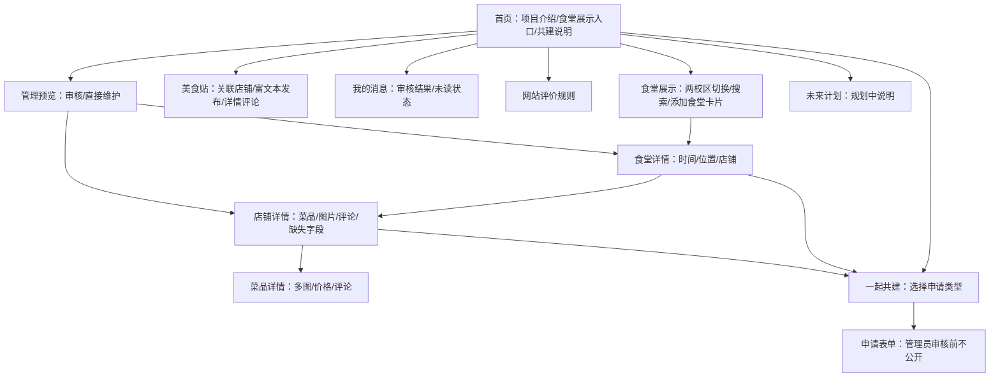

# MVP 界面规划

日期：2026-10-03｜对应实现：根目录 `index.html` 与 `src/app.js` / `src/styles.css`

## 1. 视觉方向

关键词：清新、安静、低饱和度、易读。以浅米白背景、鼠尾草绿为主色，暖杏色作少量强调；插画用 CSS 绘制餐盘，不依赖未知版权的校园或菜品照片。字号层级突出“校区 → 食堂 → 店铺”，按钮文案尽量说明下一步会发生什么。

| 用途 | 当前颜色 |
| --- | --- |
| 页面背景 | `#f7f8f3` |
| 主要文字 | `#273832` |
| 主按钮/品牌绿 | `#557b66` |
| 浅绿区域 | `#e8efe5` |
| 强调杏色 | `#d99d7f` |

## 2. 页面结构

## 3. 核心页面与空状态

| 页面 | 首屏重点 | 空数据时的动作 |
| --- | --- | --- |
| 首页 | 项目定位、食堂展示跳转、页面末尾共建说明 | “浏览食堂”和“了解共建方式”入口 |
| 食堂展示 | 两校区切换、搜索、食堂卡片 | 始终显示“添加食堂”空白卡片 |
| 食堂详情 | 名称旁照片、位置、营业时间、店铺列表 | 点击时间或位置只修改该项；照片窗口末尾可申请上传 |
| 店铺详情 | 店名旁门面或菜品封面、食堂时间、多标签、菜品或口味、图片、评论、相关美食贴 | 点击菜品条目可选择单项或多项修改；图片统一在弹窗查看 |
| 菜品详情 | 名称、价格、说明、多张图片、评论 | 可申请补充图片和资料，照片归属当前菜品 |
| 美食贴 | 关联已收录店铺，富文本编辑、正文插图、列表和详情页 | 没有店铺时提示先共建 |
| 网站评价规则 | 当前互动规则与后续投票计划 | 明确本站不设置打分 |
| 一起共建 | 食堂、店铺、菜品、营业时间四种快捷入口 | 用户按条目勾选修改；新资料可只提交名称 |
| 用户信息侧栏 | 演示身份、我的消息、我的发布、推荐票占位 | 我的消息可查看审核决定、说明和未读标记；推荐票尚未启用 |
| 管理预览 | 待审数、暂示数、正式资料数 | 审核卡片展示校区至菜品的完整位置；管理员使用完整编辑表单 |
| 未来计划 | 三维、AI、小程序、赞助 | 只展示“规划中”，不伪装已上线 |

食堂/店铺被暂示的申请与正式资料分区展示。新增食堂的暂示申请显示在对应校区食堂展示页；新增店铺和字段补充显示在对应食堂或店铺页。暂示期为管理员批准后 24 小时。

## 4. 主要交互

1. 首页点击“浏览食堂” → 食堂展示页选校区；搜索只筛选当前校区的已收录食堂，添加卡片保留。
2. 点击加号或资料条目 → 确认当前目标位置 → 勾选一个或多个要修改的字段并填写新值 → 进入待审队列。从详情页发起时，目标的上级位置固定，表单隐藏这些选择器。
3. 管理预览点击申请 → 查看新增菜品价格等完整字段 → 选择暂示、直接固定或驳回 → 回到列表查看结果。
4. 管理员可直接修改校区名称、食堂、店铺、菜品和图片；下架食堂/店铺后可恢复。
5. 食堂、店铺和菜品图片共用弹窗布局，点击窗口外空白处或右上角关闭；最后一张空白卡片用于申请上传。菜品申请可附照片；单独补充店铺图片时可选择菜品照片或店铺门面。菜品照片说明自动为菜品名；门面图片无需选择菜品。菜品详情支持多图。超过 900KB 的图片先在浏览器压缩。管理员审核卡片与确认弹窗展示图片。
6. 美食贴编辑器支持加粗、斜体、下划线、小标题、列表和正文插图；列表、详情页与店铺相关帖子互通。
7. 店铺、菜品和美食贴共用评论组件；点击菜品或美食贴卡片的空白区域可进入详情，不再单列详情按钮，菜品的字段编辑按钮保留。点击店铺标签可展开窗口，末尾空白卡片申请追加标签，心形赞同/反对按钮暂为未启用占位。当前不开放回复。用户信息侧栏可切换“发布人、浏览人、管理员”三种演示身份，查看自己的审核消息和发布概况。演示身份没有真实认证能力；正式上线仍需学校登录接口、服务器权限和完整内容审核。

## 5. 响应式与下一轮设计工作

桌面端为双栏首页与三列卡片；手机端改为单列内容、横向可滚动导航和更大的操作触区。当前本机 MySQL 以单行 JSON 保存预览状态，后续正式多用户版需设计规范化表结构、独立图片存储、真实登录与管理员权限。还需确认校区与食堂真实名称、菜品价格格式、营业时间的星期/节假日表达与图片版权。
