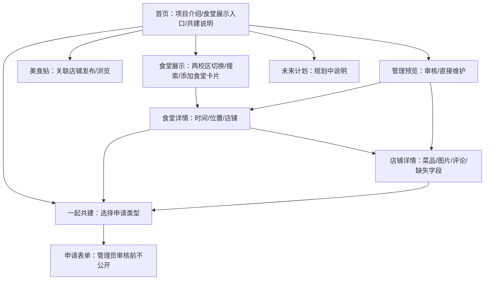

# MVP 界面规划

日期：2026-10-03｜对应实现：根目录 `index.html` 与 `src/app.js` / `src/styles.css`

## 1. 视觉方向

关键词：清新、安静、低饱和度、易读。以浅米白背景、鼠尾草绿为主色，暖杏色作少量强调；插画用 CSS 绘制餐盘，不依赖未知版权的校园或菜品照片。字号层级突出“校区 → 食堂 → 店铺”，按钮文案尽量说明下一步会发生什么。

| 用途 | 当前颜色 |
| --- | --- |
| 页面背景 | `#f7f8f3` |
| 主要文字 | `#273832` |
| 主按钮/品牌绿 | `#557b66` |
| 浅绿区域 | `#e8efe5` |
| 强调杏色 | `#d99d7f` |

## 2. 页面结构

## 3. 核心页面与空状态

| 页面 | 首屏重点 | 空数据时的动作 |
| --- | --- | --- |
| 首页 | 项目定位、食堂展示跳转、页面末尾共建说明 | “浏览食堂”和“了解共建方式”入口 |
| 食堂展示 | 两校区切换、搜索、食堂卡片 | 始终显示“添加食堂”空白卡片 |
| 食堂详情 | 名称、位置、营业时间、店铺列表 | “申请添加店铺”；时间缺失可提交补充 |
| 店铺详情 | 店名旁封面、食堂时间、菜品照片、图片、评论、相关美食贴 | 菜品/图片/位置空状态各有补充入口 |
| 美食贴 | 关联已收录店铺，发布文字与可选照片 | 没有店铺时提示先共建 |
| 一起共建 | 食堂、店铺、菜品、营业时间四种快捷入口 | 申请表单根据类型要求关联食堂/店铺 |
| 管理预览 | 待审数、暂示数、正式资料数 | 空队列清楚说明；可直接建食堂/店铺 |
| 未来计划 | 三维、AI、小程序、赞助 | 只展示“规划中”，不伪装已上线 |

食堂/店铺被暂示的申请与正式资料分区展示。新增食堂的暂示申请显示在对应校区食堂展示页；新增店铺和字段补充显示在对应食堂或店铺页。暂示期为管理员批准后 24 小时。

## 4. 主要交互

1. 首页点击“浏览食堂” → 食堂展示页选校区；搜索只筛选当前校区的已收录食堂，添加卡片保留。
2. 点击加号 → 选择校区与关联对象 → 填写已知信息 → 进入待审队列。
3. 管理预览点击申请 → 选择暂示、直接固定或驳回 → 回到列表查看结果。
4. 管理员可直接修改校区名称、食堂、店铺、菜品和图片；下架食堂/店铺后可恢复。
5. 菜品申请可附照片；单独补充图片时选择对应菜品，图片说明自动为菜品名。店铺卡片从现有菜品图片中稳定选取一张封面，未来可改为推荐票最高菜品。
6. 评论与美食贴采用演示昵称和少量测试屏蔽词，仅用于检查输入与反馈界面。

## 5. 响应式与下一轮设计工作

桌面端为双栏首页与三列卡片；手机端改为单列内容、横向可滚动导航和更大的操作触区。下一轮接正式数据前，需确认校区与食堂真实名称、菜品价格展示格式、营业时间的星期/节假日表达、图片版权与上传服务，以及真实登录后的个人中心和管理员权限界面。
