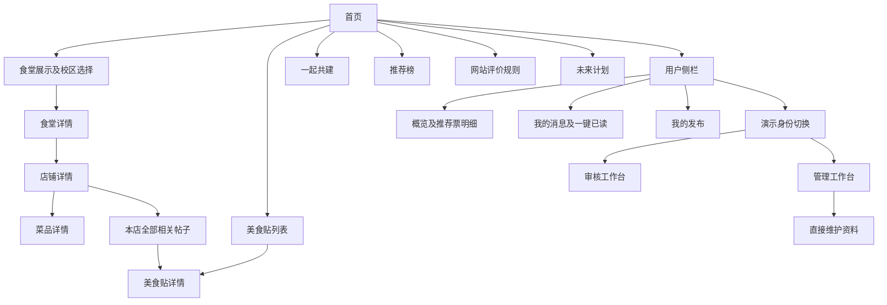

# MVP 界面与交互说明

版本：v0.3｜更新日期：2026-10-13｜对应 `src/app.js` 和 `src/styles.css`

## 1. 视觉方向

清新、低饱和度、易读；浅米白背景与绿系信息卡，少量杏色强调。首页餐盘由 CSS 绘制并有简单动画，校园真实照片由用户共建。桌面使用多栏卡片，窄屏收为单列或可滚动导航。

| 用途 | 主要颜色 |
| --- | --- |
| 背景 | `#f7f8f3` |
| 正文 | `#273832` |
| 主按钮 / 品牌 | `#557b66` |
| 浅绿区域 | `#e8efe5` |
| 杏色强调 | `#d99d7f` |

## 2. 导航与页面

审核员和管理员均可进入审核区域，只有管理员有直接维护区域。流程图不代表正式登录已经实现。

食堂、店铺、菜品和帖子有独立 URL；直接打开或刷新会恢复详情。目录面包屑包括校区和上级，避免店铺页无法回到食堂。

## 3. 页面行为

| 页面 / 部件 | 当前布局与交互 |
| --- | --- |
| 首页 | 浏览食堂按钮、共建说明锚点、本周三店、CSS 动画；无重复食堂导览 |
| 食堂展示 | 当前校区的食堂搜索；食堂封面取已有图片；添加卡片始终存在 |
| 食堂详情 | 标题右侧图片放大展示区；营业时间与位置可点击申请修改；底部前六条固定记录不带赞同反对 |
| 店铺卡片 | 整张卡片进入详情，不放“查看详细”；经营状态和标签保留 |
| 店铺详情 | 标题图、状态色、位置、标签弹窗、推荐票、菜品、评论；图片与相关帖子在侧栏呈现 |
| 菜品卡片 | 圆角高亮和内部缩进；点击空白进入详情，不直接修改菜品字段 |
| 菜品详情 | 名称、价格、说明、供应状态使用统一可点击字段；照片多图入口和评论 |
| 相关帖子 | 店铺详情显示最高赞同前三；另开页面看全部；无重复“发帖”按钮 |
| 美食贴 | 筛选校区 / 食堂 / 店铺；按时间或赞同数排序；卡片空白进入详情 |
| 下拉选择 | 使用统一自定义选择样式；发帖关联店铺另有模糊搜索；普通下拉不强加搜索 |
| 图片预览 | 店铺及菜品图片取最多三张，正方形堆叠，使用稳定取样；所有图片在弹窗列出 |

## 4. 图片上传与放大

图片窗口最后一张空白卡片用于申请上传。食堂图片固定关联食堂；店铺上传可选择门面或菜品，门面无需选择菜品。从菜品详情发起时菜品目标锁定。

描述为选填最多 200 字，与分类和菜品名分开。上传 JPG / PNG / WebP，超过 900,000 字节先压缩。美食贴编辑器中可先填写“下一张图片的描述”，再添加插图。

缩略图先展示，点图放大后原图加载完成才显现。底部格式例如：

> 菜品照片 · 番茄面　发布人想说：这碗面刚出锅！

未填写或旧图片显示“未填写描述”。点空白、叉或 Escape 关闭。审核卡片和确认弹窗展示图片与描述，也可放大查看。

## 5. 共建表单与审核

用户从资料字段或空白卡片发起申请，既可只提交一项，也可勾选多项。详情页中已确定的校区、食堂、店铺或菜品隐藏相应选择器，保留可读的“提交到这里”路径。

管理员直接维护使用完整编辑表单。审核员只看提交字段，不可把审核行为变成自行改写正式资料。审核卡片和确认弹窗展示位置、价格、标签、变更字段、图片分类、描述和提交者，选择暂示、固定或驳回后反馈给申请人。

24 小时暂示与正式资料分区。固定资料争议进入工作台复核；暂示和固定记录的表态规则见互动规则文档。

## 6. 用户侧栏

| 栏目 | 展示 |
| --- | --- |
| 概览 | 可用推荐票卡片、积分试行卡片、本周推荐榜入口；不重复放“我的消息 / 我的发布”快捷项 |
| 推荐票明细 | 点击概览卡片打开；奖励来源和使用状态、投票店铺与时间、基础 / 额外票、旧关联推定提示，可继续展开 |
| 我的消息 | 共建状态与审核说明、未读标记、单条已读和全部标为已读 |
| 我的发布 | 本人帖子、评论、图片计数及部分帖子入口 |
| 身份切换 | 发布人、浏览人、审核员、管理员；当前为演示账号选择 |

积分卡片按成功投票次数累计，文字明确兑换尚未开放。

## 7. 工作台

- 共建区包含待审申请、暂示处理和固定争议复核。
- 内容区使用单列卡片，支持类型、公开状态、关键词、时间或反对数排序；首批十二条，继续展开更多。
- 管理员直接维护区左侧食堂选择会过滤右侧店铺。
- 审核员工作台不显示直接维护、恢复已下架目录和清空按钮；接口同样执行角色校验。

## 8. 后续界面需求

正式登录 / 退出、账户设置、收藏、发布后编辑、完整我的发布管理、举报与申诉、积分兑换、低参与店铺探索尚未实现。三维、AI、小程序和赞助入口只展示规划说明。响应式布局已编写，真实设备视觉和辅助访问验收仍需逐轮执行。
