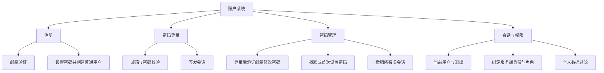
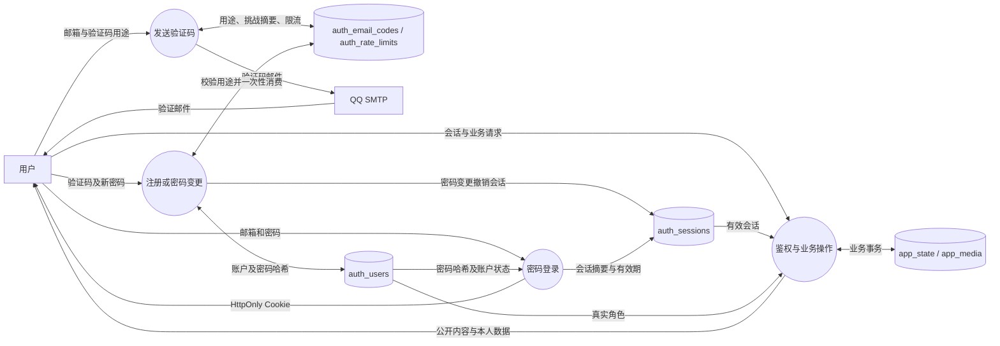

# 邮箱与密码用户系统

更新日期：2026-10-13。本文描述当前已实现的账户系统，替代此前的验证码直接登录设计。浏览器本地预览仍保留演示账户；MySQL 模式使用真实账户与服务端会话。

## 1. 用户流程

| 场景 | 用户步骤 | 登录状态 |
| --- | --- | --- |
| 注册 | 邮箱、昵称（选填）、密码、确认密码、注册验证码 | 首次创建普通用户，自动登录 |
| 登录 | 邮箱 + 网站密码 | 登录有效期 7 天，无需发送邮件 |
| 找回 / 首次设置密码 | 邮箱、新密码、确认密码、找回用途验证码 | 更新已有账户密码，全部旧会话失效，返回登录 |
| 修改密码 | 登录后在用户侧栏点击修改密码；新密码、确认密码、当前账户邮箱验证码 | 更新本人密码，全部旧会话失效，返回登录 |
| 退出 | 用户侧栏点击退出登录 | 撤销当前会话，其他设备独立 |

网站密码独立于邮箱登录密码和 SMTP 授权码。长度 8–128 个字符，允许空格及 Unicode，不对输入进行 trim 或截断。密码和确认密码必须一致。已有验证码账户以及人工创建的管理员账户密码字段初始为空，通过「找回 / 首次设置密码」验证邮箱后设置；不提供默认密码。

注册已有邮箱不能覆盖账户或密码；重置密码仅针对已有账户。修改密码的目标邮箱由服务端会话确定，客户端不能修改他人的密码。验证码不再用于直接登录。

游客可浏览公开内容。发布评论和帖子、投推荐票、赞同反对、共建及个人消息需要登录。新注册用户始终为 member；管理员或审核员由数据库维护人员显式设置，发信邮箱不自动获得管理权限。密码变更保留用户 ID、昵称、角色、已有内容、推荐票及奖励。

## 2. 功能分解

## 3. DFD

## 4. 数据库与迁移

所有表在 DB_NAME 指定数据库中，默认 canteen_guide_mvp。实际建表及增量迁移位于 auth-store.mjs，启动连接数据库时自动执行；数据库账号需要 ALTER 权限。已有业务 JSON、图片、账户角色和 ID 保留。

| 表 | 主要字段 |
| --- | --- |
| auth_users | UUID、唯一邮箱、昵称、member/reviewer/admin 角色、active/blocked 状态、验证时间；新增可空 password_hash 和 password_updated_at |
| auth_email_codes | 邮箱主键、挑战 ID、验证码 HMAC 摘要、purpose、10 分钟有效期、重发时间、错误次数、一次性消费时间、投递状态、小时发送次数 |
| auth_sessions | Cookie 令牌 SHA-256 摘要、关联用户、7 天有效期 |
| auth_rate_limits | IP 或邮箱与用途的摘要键、窗口截止时间、次数 |

迁移前的验证码用途标记为 legacy，不可用于新流程。注册、修改密码、找回密码用途分别为 register、change-password、reset-password；用途写入数据库并参与验证码 HMAC，不能互相使用。同一邮箱仅保留最新挑战，重发使旧挑战失效。

密码使用 Node.js scrypt 和每次随机盐，参数 N=32768、r=8、p=3，64 字节派生结果。数据库仅保存算法参数、盐和哈希，不保存明文。密码比较采用 timingSafeEqual。未知账户也执行密码哈希计算，登录失败统一提示。密码验证后签发会话前再次锁定账户检查哈希，防止并发重置期间旧密码签发新会话。

验证码消费、账户创建、密码写入、会话创建或撤销在事务中完成。同一挑战并发验证最多成功一次。修改或找回密码保留角色并撤销该账户全部会话。公开状态不返回密码哈希、验证码或邮箱；本人邮箱只通过 /api/auth/me 返回。排行榜使用全站聚合数，票据及奖励只返回本人数据。

## 5. 接口

| 接口 | 参数与结果 |
| --- | --- |
| GET /api/auth/me | 当前用户或 null、邮件配置是否启用 |
| POST /api/auth/send-code | email、purpose；修改密码时邮箱由会话确定；返回 challengeId、expiresIn=600、retryAfter=60，不返回验证码 |
| POST /api/auth/login | email、password；返回用户并设置会话 Cookie |
| POST /api/auth/register | email、name（选填）、password、confirmPassword、challengeId、code；创建普通用户并自动登录 |
| POST /api/auth/reset-password | email、password、confirmPassword、challengeId、code；仅更新已有账户，撤销全部会话，清除 Cookie |
| POST /api/auth/change-password | 必须已登录；password、confirmPassword、challengeId、code；更新当前账户，撤销全部会话，清除 Cookie |
| POST /api/auth/logout | 撤销当前会话并清除 Cookie |

原 /api/auth/verify-code 已移除，返回 404。业务请求中的 actorId 和角色不能替代服务端身份。

## 6. 限流与配置

- 同一邮箱重发间隔 60 秒，每小时最多 5 次；所有用途共享限额。
- 同一连接 IP 每 10 分钟发送最多 10 次、验证码验证 30 次、密码登录 20 次。
- 同一邮箱每 10 分钟最多 10 次密码登录尝试。
- 每个验证码最多输错 5 次，10 分钟有效，仅使用一次。
- QQ SMTP 使用 smtp.qq.com:465 和 TLS，认证使用授权码。
- SMTP_PASS 和 AUTH_CODE_SECRET 只放在 .env.local 或环境变量；.env.local 被 Git 忽略。
- Cookie 为 HttpOnly、SameSite=Lax；HTTPS 部署设置 AUTH_COOKIE_SECURE=true。
- 当前监听 127.0.0.1，连接 IP 直接用于限流；反向代理部署需另行设计可信代理识别并保留正确 Host。

参考 .env.example。环境配置修改后重启服务。node scripts/verify-smtp.mjs 只验证 SMTP 连接，不发送邮件。测试数据脚本需 SEED_SESSION_COOKIE 提供已登录管理员会话，不支持演示身份绕过。

## 7. 验证与当前边界

登录、注册及密码管理使用页面中央的独立窗口；登录后的个人消息、票据和发布记录继续使用用户侧栏。点击输入框不会触发背景关闭或改变验证码用途，发信后保留密码草稿。`node tests/account-dialog.mjs` 使用 jsdom 和模拟账户覆盖真实 DOM 点击、事件冒泡、填写密码后发送验证码、密码重置后登录以及修改密码流程，不发送真实邮件或更改真实账户。

node tests/email-auth.mjs 使用独立临时本地 MySQL 数据库和模拟邮件投递。覆盖注册、并发一次性校验、用途隔离、密码哈希、密码登录、错误密码、找回与修改密码、所有会话撤销、既有管理员首次设置密码、权限伪造拦截、真实账户评论及推荐票、隐私与全站周榜；不向真实邮箱发信，不修改现有业务数据。

尚未提供邮箱或昵称修改、账户注销、后台用户管理、全部设备退出入口、机器人验证或学校身份绑定。数据库 blocked 状态可使会话无效，尚无管理界面。邮箱验证不证明学校身份，同一人仍可能使用多个邮箱注册，不能视为已彻底解决刷票。

设计依据：[OWASP 密码存储](https://cheatsheetseries.owasp.org/cheatsheets/Password_Storage_Cheat_Sheet.html)、[密码找回](https://cheatsheetseries.owasp.org/cheatsheets/Forgot_Password_Cheat_Sheet.html)。
